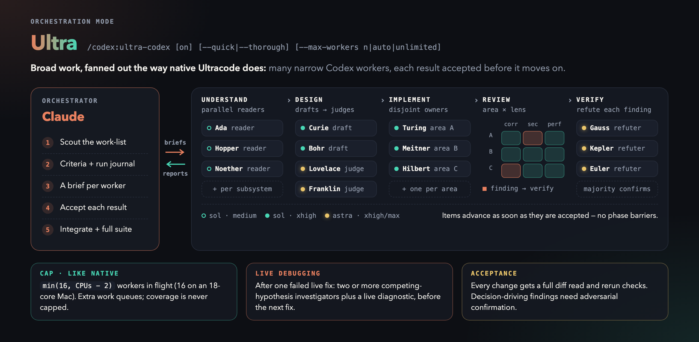
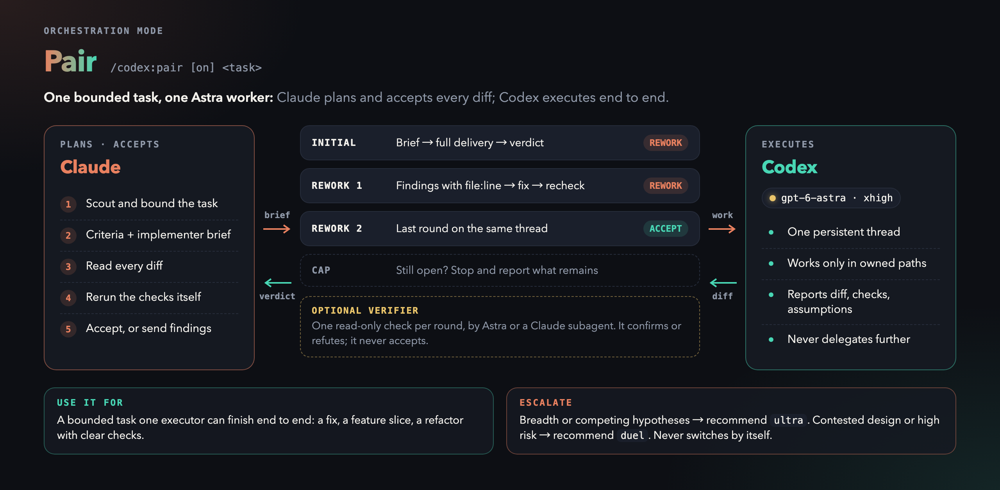
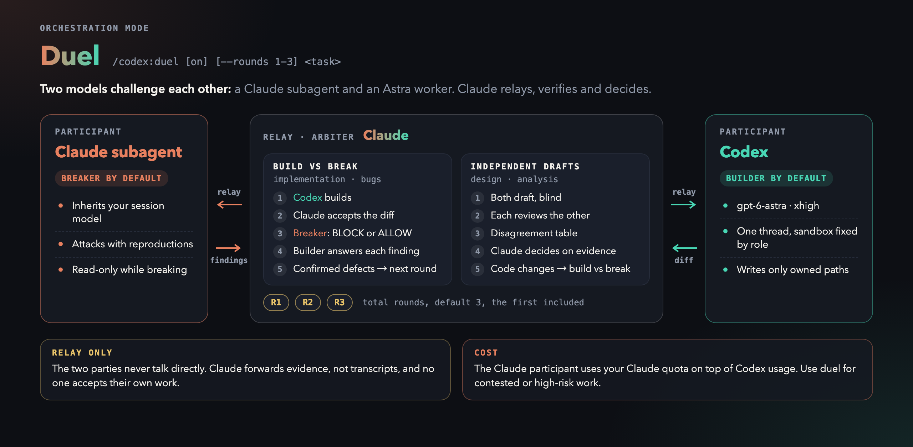

<p align="center">
  
</p>

<p align="center">
  <b>Claude Code × Codex, working as one team.</b><br>
  Claude plans, writes the briefs and accepts the work. Codex workers investigate, implement and review in parallel, in their own isolated home.
</p>

<p align="center">
  <a href="#install">Install</a> ·
  <a href="#quick-start">Quick start</a> ·
  <a href="#how-it-works">How it works</a> ·
  <a href="#three-orchestration-modes">Modes</a> ·
  <a href="#features">Features</a> ·
  <a href="#documentation">Docs</a>
</p>

---

## Why Duet

- **Claude briefs and checks the work.** Each Codex worker is a native agent
  call. Its result is a compact report: Codex's summary, captured evidence and
  the next command. Claude checks the diff and the verification before
  accepting anything.
- **Workers can talk back.** Codex can ask Claude a question mid-task
  (`ask_parent`), and the answer continues the same turn. Stopping a job really
  stops it; stopped work can be continued or adopted later.
- **Evidence over claims.** Every turn ends in a schema-checked report that
  separates what was observed from what Codex claims. Claude's verdicts go into
  a run journal that survives context compaction.
- **Nothing leaks into your everyday Codex.** Auth, threads and job state live
  in `~/.claude/codex-isolated`; Duet never writes `~/.codex`.
- **You can watch it.** The `codex-live` pane and `/tasks` show each worker
  live, at no Claude token cost.

## How it works

<p align="center">
  
</p>

1. **Claude** scouts the code and writes acceptance criteria and a precise brief
   for each worker.
2. The **Duet companion** runs each job on its own Codex thread and stays
   attached as its owner: lease, heartbeat, questions and stops.
3. **Codex workers** run in parallel and finish with a structured report.
4. **Claude** checks each report against its criteria, records a verdict and
   integrates the work.

## Install

```bash
/plugin marketplace add Ghqqqq/codex-duet     # or an absolute path to a local checkout
/plugin install codex@duet
/plugin install codex-live@duet                # optional live pane
/reload-plugins
/codex:setup                                   # check the runtime, then sign in once
```

`/codex:setup` prints a login command for the isolated home; prefix it with `!`
to run it in the session.

**Requirements:**
- Claude Code 2.1.302 or later with plugin support;
- Node.js 18.18+;
- a Codex CLI (`codex` on PATH or a [pinned binary](docs/configuration.md#runtime-selection));
- a ChatGPT plan (including Free) or an OpenAI API key. Usage counts toward your normal Codex limits.

> Upgrade or downgrade only while no Duet jobs are running. Workers from
> different versions can overwrite shared job state.
> Setup warns (`desktop_managed_codex_runtime`) when the Codex CLI is managed by
> a desktop app whose updates can stop running turns. Use a
> [stable CLI pin](docs/configuration.md#runtime-selection) instead.

## Quick start

Ask Claude to delegate:

```text
Have Codex investigate why the integration tests are flaky, and in parallel have
another Codex worker review the retry logic in src/net/.
```

For a substantial task, hand the whole orchestration over, once or for the rest
of the session with `on`:

```text
/codex:ultra-codex add a --json flag to the cancel command and cover it with a test
/codex:pair fix the failing parser test
/codex:duel compare these two designs
```

| Command | What it does |
| --- | --- |
| `/codex:ultra-codex <task>` · `on` · `off` | Claude orchestrates parallel Codex workers end to end, once or as a session mode |
| `/codex:pair <task>` · `on` · `off` | One Codex thread executes; Claude accepts every diff |
| `/codex:duel <task>` · `on` · `off` | Claude and Codex challenge each other; the Claude participant uses your Claude quota |
| `/codex:review` · `/codex:adversarial-review` | Read-only Codex review of your changes; the adversarial one challenges the design |
| `/codex:rescue <task>` | Hand one task to Codex: investigate, fix, or continue earlier work |
| `/codex:status` · `/codex:result` · `/codex:cancel` | Inspect, read or stop jobs |
| `/codex:transfer` | Continue the current Claude conversation in Codex |
| `/codex:setup` | Check the runtime; opt into browser/desktop tools and other settings |

To have Claude orchestrate every substantive task without typing a command,
start each fresh session in a mode with `/codex:setup --default-mode pair` (or
`ultra` / `duel`; the default is `off`), or paste the optional
[CLAUDE.md policy](docs/claude-md.md) for proactive delegation outside a mode.
Duet also ships its own dispatch and acceptance rules, so neither is required.

Every command and flag: [docs/commands.md](docs/commands.md).

## Three orchestration modes

Pick the mode by the shape of the task. Claude always plans, writes the briefs
and accepts the work; the modes differ in who does the work and how it is
checked.

| | [Ultra](docs/ultra-codex.md) | [Pair](docs/pair.md) | [Duel](docs/duel.md) |
| --- | --- | --- | --- |
| Best for | Broad work: audits, migrations, multi-module features | One bounded task: a fix, a feature slice | Contested designs, high-risk changes |
| Who works | Many Codex workers in parallel | One Codex worker on one thread | One Claude subagent versus one Codex worker |
| Models (configurable) | Routine model (default `gpt-6.1-sol`) by stage; worker model (default `gpt-6-astra`) verifies and judges | Worker model (default `gpt-6-astra`) · worker effort (default `xhigh`) | Worker model (default `gpt-6-astra`) · worker effort (default `xhigh`) plus your session model |
| Limit | min(16, CPUs − 2) workers in flight | Two rework rounds | Three rounds (`--rounds 1-3`) |
| Claude quota | Orchestration only | Orchestration only | Also the Claude participant |

Run a task once with `/codex:<mode> <task>`, keep the mode for the session with
`on`, and clear it with `off`. One mode is active at a time, and
`setup --default-mode ultra|pair|duel` starts every fresh session in one.

### Ultra: fan out like native Ultracode

<p align="center">
  
</p>

Claude splits the work-list and runs parallel readers, independent design
drafts with judges, one implementer per disjoint area, an area × lens review
matrix and adversarial refuters for each finding. Each item moves on as soon as
its result is accepted. After one failed live fix, Claude fans out competing
hypotheses and a live diagnostic instead of guessing again. `--quick` and
`--thorough` set the depth; `--max-workers` changes the cap, which limits
concurrency, never coverage.

### Pair: one task, one executor

<p align="center">
  
</p>

Claude writes the criteria and a full brief, then one Codex worker does the task
end to end on a single thread. Claude reads every diff and reruns the checks
itself. At most two rework rounds follow the first delivery, and an optional
read-only verifier can challenge a round. When the task outgrows one worker,
Claude recommends ultra or duel; it never switches on its own.

### Duel: two models challenge each other

<p align="center">
  
</p>

For code and bugs, Codex builds and the Claude subagent tries to break it; each
finding gets an answer before the next round. For design questions, both draft
blind, review each other's draft, and Claude decides on the evidence. The
parties never talk directly: Claude relays evidence, not transcripts, and no one
accepts their own work. The Claude participant uses your Claude quota.

## Features

### Codex as a native subagent

Claude calls `Agent(subagent_type: "codex:codex-native", prompt: "<brief>")`.
An optional first line such as `DUET: --sandbox read-only --effort xhigh` sets
Codex flags. Each worker gets a name from a scientist pool (Ada, Noether,
Turing, …) that the agent, `codex-live` and the report all share. A SendMessage
to that name continues the thread or answers a pending question; stop a worker
from `/tasks`. → [Native dispatch](docs/direct-mode.md#native-subagent-default)

### Fallback: background workers

Native dispatch is the default. Only when it is unavailable, or a call needs an
option the `DUET:` line rejects, does Claude load the `codex:native-fallback`
skill and run one background Bash call per job:

```bash
duet task --model gpt-6-astra --effort xhigh --normal <<'DUET_TASK'
<brief: objective, context, owned paths, constraints, acceptance criteria>
DUET_TASK
```

The report arrives with the completion notification, and `duet result <worker>
--details` shows the full evidence. Typed blockers point at their recovery:
`duet setup` for auth, a fresh task for a full context window or a provider
refusal. A tracked job that ends without delivering its report triggers one
recovery notice on the next prompt, and a completed job whose final turn was
left open is reconciled automatically about 15 seconds later.
→ [Direct mode](docs/direct-mode.md) · [Worker lifecycle](docs/worker-lifecycle.md)

### Live view: `codex-live` and `/tasks`

`codex-live` is a read-only pane that draws every worker the way Claude Code
draws its own transcript. It shows prompts, tool calls, file changes, plans and
pending questions, and keeps follow-ups on one thread in one conversation.
Status labels make it clear what needs you: **Question for Claude**, **Needs your
attention** or **Outcome unknown**. `/codex-live` opens it at any width. `/tasks`
shows compact progress such as `Bash(npm test) · Done (21.1s)`. The native agent
view groups it: consecutive commands it can confirm are read-only fold into one
`Explored · 6 commands` row, and every other step takes one row ending in a
status such as `✓ 21.1s` or `✗ exit 1`.

<p align="center">
  
</p>
<p align="center"><sub>The codex-live pane, drawn by its own layout code from three real jobs on a small demo repository.</sub></p>

### Run journal

Each run keeps a journal in the isolated home with the goal, criteria, briefs,
reports, verdicts and decisions. Claude recovers it with `journal show` after
compaction, and `journal validate` must pass before a passed close.
→ [Run journal](docs/run-journal.md)

### Browser and desktop work

Optional Chrome and Computer Use tooling, mirrored from your own Codex app. Each
assignment gets a fresh, session-owned tab. App approvals you already granted
carry over, and anything new is asked of Claude.
→ [Browser approvals](docs/browser-approvals.md) · [Computer Use approvals](docs/computer-use-approvals.md)

### Reviews

`/codex:review` and `/codex:adversarial-review` cover the repository from any
subdirectory. They keep your focus text exactly as typed, and the full findings
stay available through `result --details`. → [Commands](docs/commands.md)

## Defaults

| Setting | Default | Change it with |
| --- | --- | --- |
| Model · effort · speed | configured; built-in `gpt-6-astra` · `xhigh` · normal (ultra uses the configured routine model, default `gpt-6.1-sol`, or worker model by stage) | `duet models` lists what your account offers; `setup --default-model …`, `--default-effort …`, `--ultra-routine-model …`; `--model`, `--effort`, `--fast` per call |
| Orchestration mode in a fresh session | off | `setup --default-mode ultra\|pair\|duel` |
| Codex sandbox | full access, like the Codex app's own full-access mode | `setup --default-sandbox …`, or `--sandbox` per call |
| Browser | any site, no per-origin prompt | `setup --browser-approval ask` |
| Computer Use apps | mirror your Codex app's "always allow" list | `setup --computer-use-approval ask` |
| Claude instructions | loaded CLAUDE.md/rules forwarded to Codex | `--no-claude-md`, `CODEX_COMPANION_CLAUDE_MD=0` |
| Codex project discovery | `CLAUDE.md` where no `AGENTS.md` exists | `duet setup --project-docs agents-only` |
| Wait budget · owner lease | 3600 s · 1800 s | `--timeout-sec`, `--lease-sec` |
| Runtime start deadline | 60 s | `CODEX_COMPANION_CONNECT_TIMEOUT_MS` |
| Retention | Claude Code's `cleanupPeriodDays` (30 days) | `cleanup --days N`, `CODEX_COMPANION_RETENTION_DAYS` |

Mode reminders and status show the effective model values. Change them in
[Default worker models](docs/configuration.md#default-worker-models); the diagrams
above illustrate the built-in choices. Full table and the security implications
of each setting:
[docs/configuration.md](docs/configuration.md).

## Documentation

| Topic | Page |
| --- | --- |
| Native/Bash dispatch, reports, questions, stops and recovery | [Direct mode](docs/direct-mode.md) · [Worker lifecycle](docs/worker-lifecycle.md) |
| Orchestration modes and shared protocol | [Ultra-codex](docs/ultra-codex.md) · [Pair](docs/pair.md) · [Duel](docs/duel.md) |
| Optional CLAUDE.md policy for proactive delegation | [CLAUDE.md policy](docs/claude-md.md) |
| Run journal format and commands | [Run journal](docs/run-journal.md) |
| All slash commands and companion subcommands | [Commands](docs/commands.md) |
| Sandbox, browser, Computer Use, transport, runtime binary | [Configuration](docs/configuration.md) · [Browser approvals](docs/browser-approvals.md) · [Computer Use approvals](docs/computer-use-approvals.md) |
| Where state lives, migration, cleanup | [State and retention](docs/state-and-retention.md) |
| Operating notes, slow starts, blocked workers | [Worker operations](docs/worker-operations.md) · [Troubleshooting](docs/troubleshooting.md) |
| Release notes and known limits per version | [CHANGELOG](plugins/codex/CHANGELOG.md) |

## Known limitations

- Codex edits bypass Claude Code's permission prompts and rewind. The report's
  touched-file snapshot, the Codex sandbox and `git diff` are the controls.
- File attribution is unreliable when several writers share one checkout. Give
  parallel writers disjoint paths or separate worktrees.
- Sixteen read-only workers were measured in flight together; larger or heavy
  mutating fan-out is not a measured guarantee.
- The native adapter and `codex-live` need Claude Code's 2.1.302 function-hook
  APIs.

More: [docs/troubleshooting.md](docs/troubleshooting.md#known-limitations).

## Development

After `npm ci`, install the pinned CLI versions:

```bash
npm install -g "@openai/codex@$(cat .codex-version)" "@anthropic-ai/claude-code@$(cat .claude-code-version)"
```

Before pushing a release to main, run:

```bash
npm run verify
```

It checks version metadata, builds TypeScript, and runs the runtime tests and then the live-pane tests.
CI runs the same checks for pull requests and pushes to main. The tests use
temporary Codex homes only: they refuse to touch `~/.claude/codex-isolated` or
`~/.codex`, and check that no spawned process survives. Local-socket tests are
skipped inside a sandbox, so run them outside one for full coverage.

## License

Apache-2.0. See [LICENSE](LICENSE) and [NOTICE](NOTICE). Duet is a fork of
[openai/codex-plugin-cc](https://github.com/openai/codex-plugin-cc) (upstream
`db52e28` / 1.0.6). The review and rescue commands come from upstream; the
worker runtime, isolation, lifecycle, orchestration and live view are Duet
additions.
