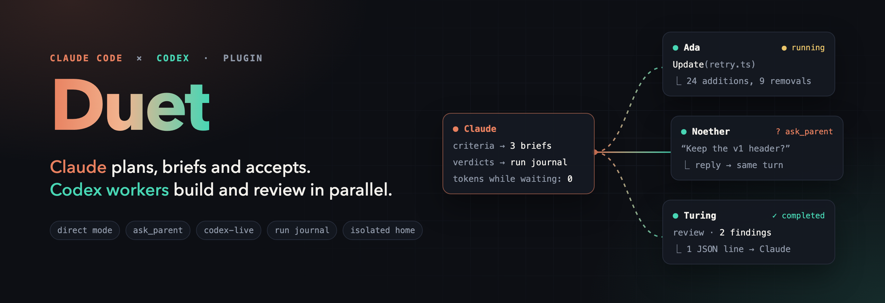
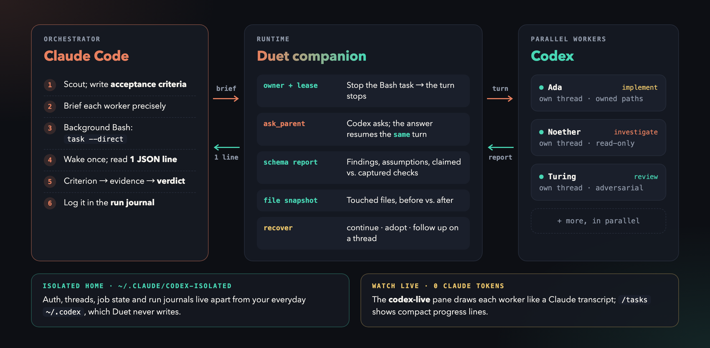
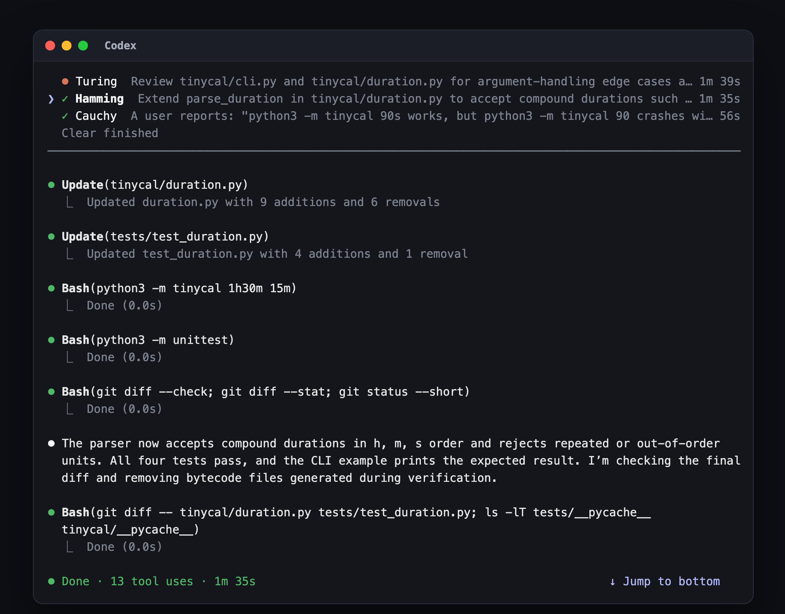

<p align="center">
  
</p>

<p align="center">
  <b>Claude Code × Codex, working as one team.</b><br>
  Claude plans, writes the briefs and accepts the work. Codex workers investigate, implement and review in parallel, in their own isolated home.
</p>

<p align="center">
  <a href="#install">Install</a> ·
  <a href="#quick-start">Quick start</a> ·
  <a href="#how-it-works">How it works</a> ·
  <a href="#features">Features</a> ·
  <a href="#documentation">Docs</a>
</p>

---

## Why Duet

- **Claude briefs and checks the work.** Each Codex worker is a native agent
  call. Its result is a compact report: Codex's summary, captured evidence and
  the next command. Claude checks the diff and the verification before
  accepting anything.
- **Workers can talk back.** Codex can ask Claude a question mid-task
  (`ask_parent`), and the answer continues the same turn. Stopping a job really
  stops it; stopped work can be continued or adopted later.
- **Evidence over claims.** Every turn ends in a schema-checked report that
  separates what was observed from what Codex claims. Claude's verdicts go into
  a run journal that survives context compaction.
- **Nothing leaks into your everyday Codex.** Auth, threads and job state live
  in `~/.claude/codex-isolated`; Duet never writes `~/.codex`.
- **You can watch it.** The `codex-live` pane and `/tasks` show each worker
  live, at no Claude token cost.

## How it works

<p align="center">
  
</p>

1. **Claude** scouts the code and writes acceptance criteria and a precise brief
   for each worker.
2. The **Duet companion** runs each job on its own Codex thread and stays
   attached as its owner: lease, heartbeat, questions and stops.
3. **Codex workers** run in parallel and finish with a structured report.
4. **Claude** checks each report against its criteria, records a verdict and
   integrates the work.

## Install

```bash
/plugin marketplace add Ghqqqq/codex-duet     # or an absolute path to a local checkout
/plugin install codex@duet
/plugin install codex-live@duet                # optional live pane
/reload-plugins
/codex:setup                                   # check the runtime, then sign in once
```

`/codex:setup` prints a login command for the isolated home; prefix it with `!`
to run it in the session.

**Requirements:**
- Claude Code 2.1.302 or later with plugin support;
- Node.js 18.18+;
- a Codex CLI (`codex` on PATH or a [pinned binary](docs/configuration.md#runtime-selection));
- a ChatGPT plan (including Free) or an OpenAI API key. Usage counts toward your normal Codex limits.

> Upgrade or downgrade only while no Duet jobs are running. Workers from
> different versions can overwrite shared job state.
> Setup warns (`desktop_managed_codex_runtime`) when the Codex CLI is managed by
> a desktop app whose updates can stop running turns. Use a
> [stable CLI pin](docs/configuration.md#runtime-selection) instead.

## Quick start

You rarely call anything yourself. Ask Claude to delegate, or let it decide that
a task benefits from independent workers:

```text
Have Codex investigate why the integration tests are flaky, and in parallel have
another Codex worker review the retry logic in src/net/.
```

For a substantial task, hand the whole orchestration over:

```text
/codex:ultra-codex add a --json flag to the cancel command and cover it with a test
```

| Command | What it does |
| --- | --- |
| `/codex:ultra-codex <task>` · `on` · `off` | Claude orchestrates parallel Codex workers end to end, once or as a session mode |
| `/codex:review` · `/codex:adversarial-review` | Read-only Codex review of your changes; the adversarial one challenges the design |
| `/codex:rescue <task>` | Hand one task to Codex: investigate, fix, or continue earlier work |
| `/codex:status` · `/codex:result` · `/codex:cancel` | Inspect, read or stop jobs |
| `/codex:transfer` | Continue the current Claude conversation in Codex |
| `/codex:setup` | Check the runtime; opt into browser/desktop tools and other settings |

Every command and flag: [docs/commands.md](docs/commands.md).

## Features

### Codex as a native subagent

Claude calls `Agent(subagent_type: "codex:codex-native", prompt: "<brief>")`.
An optional first line such as `DUET: --sandbox read-only --effort xhigh` sets
Codex flags. Each worker gets a name from a scientist pool (Ada, Noether,
Turing, …) that the agent, `codex-live` and the report all share. A SendMessage
to that name continues the thread or answers a pending question; stop a worker
from `/tasks`. → [Native dispatch](docs/direct-mode.md#native-subagent-default)

### Background workers

When native dispatch is unavailable, or a call needs an option the `DUET:` line
rejects, Claude falls back to one background Bash call per job:

```bash
duet task --model gpt-6-astra --effort xhigh --normal <<'DUET_TASK'
<brief: objective, context, owned paths, constraints, acceptance criteria>
DUET_TASK
```

The report arrives with the completion notification. `duet task --to <worker>`
continues a worker, and `duet result <worker> --details` shows the full evidence.
Typed blockers point at their recovery: `duet setup` for auth, a fresh task for
a full context window or a provider refusal. A tracked job that ends without
delivering its report triggers one recovery notice on the next prompt.
→ [Direct mode](docs/direct-mode.md) · [Worker lifecycle](docs/worker-lifecycle.md)

### Live view: `codex-live` and `/tasks`

`codex-live` is a read-only pane that draws every worker the way Claude Code
draws its own transcript. It shows prompts, tool calls, file changes, plans and
pending questions, and keeps follow-ups on one thread in one conversation.
Status labels make it clear what needs you: **Question for Claude**, **Needs your
attention** or **Outcome unknown**. `/codex-live` opens it at any width. `/tasks`
and the native agent view show compact progress such as
`Bash(npm test) · Done (21.1s)`.

<p align="center">
  
</p>
<p align="center"><sub>The codex-live pane, drawn by its own layout code from three real jobs on a small demo repository.</sub></p>

### Ultra-codex orchestration and the run journal

`/codex:ultra-codex` applies Ultracode-style orchestration with Codex as the
workforce:
- briefs follow a fixed template;
- every report passes one acceptance protocol: scope check, diff review, then
  criterion → evidence → verdict (`ACCEPT` / `ACCEPT WITH GLUE` / `REWORK` /
  `REASSIGN`).

Each run keeps a journal in the isolated home with the goal, criteria, briefs,
reports, verdicts and decisions. Claude recovers it with `journal show` after
compaction, and `journal validate` must pass before a passed close.
→ [Ultra-codex](docs/ultra-codex.md) · [Run journal](docs/run-journal.md)

### Browser and desktop work

Optional Chrome and Computer Use tooling, mirrored from your own Codex app. Each
assignment gets a fresh, session-owned tab. App approvals you already granted
carry over, and anything new is asked of Claude.
→ [Browser approvals](docs/browser-approvals.md) · [Computer Use approvals](docs/computer-use-approvals.md)

### Reviews

`/codex:review` and `/codex:adversarial-review` cover the repository from any
subdirectory. They keep your focus text exactly as typed, and the full findings
stay available through `result --details`. → [Commands](docs/commands.md)

## Defaults

| Setting | Default | Change it with |
| --- | --- | --- |
| Model · effort · speed | `gpt-6-astra` · `xhigh` · normal | `--model`, `--effort`, `--fast` per call |
| Codex sandbox | full access, like the Codex app's own full-access mode | `setup --default-sandbox …`, or `--sandbox` per call |
| Browser | any site, no per-origin prompt | `setup --browser-approval ask` |
| Computer Use apps | mirror your Codex app's "always allow" list | `setup --computer-use-approval ask` |
| Claude instructions | loaded CLAUDE.md/rules forwarded to Codex | `--no-claude-md`, `CODEX_COMPANION_CLAUDE_MD=0` |
| Codex project discovery | `CLAUDE.md` where no `AGENTS.md` exists | `duet setup --project-docs agents-only` |
| Wait budget · owner lease | 3600 s · 1800 s | `--timeout-sec`, `--lease-sec` |
| Runtime start deadline | 60 s | `CODEX_COMPANION_CONNECT_TIMEOUT_MS` |
| Retention | Claude Code's `cleanupPeriodDays` (30 days) | `cleanup --days N`, `CODEX_COMPANION_RETENTION_DAYS` |

Full table and the security implications of each setting:
[docs/configuration.md](docs/configuration.md).

## Documentation

| Topic | Page |
| --- | --- |
| Native/Bash dispatch, reports, questions, stops and recovery | [Direct mode](docs/direct-mode.md) · [Worker lifecycle](docs/worker-lifecycle.md) |
| Orchestration protocol and phases | [Ultra-codex](docs/ultra-codex.md) |
| Run journal format and commands | [Run journal](docs/run-journal.md) |
| All slash commands and companion subcommands | [Commands](docs/commands.md) |
| Sandbox, browser, Computer Use, transport, runtime binary | [Configuration](docs/configuration.md) · [Browser approvals](docs/browser-approvals.md) · [Computer Use approvals](docs/computer-use-approvals.md) |
| Where state lives, migration, cleanup | [State and retention](docs/state-and-retention.md) |
| Operating notes, slow starts, blocked workers | [Worker operations](docs/worker-operations.md) · [Troubleshooting](docs/troubleshooting.md) |
| Release notes and known limits per version | [CHANGELOG](plugins/codex/CHANGELOG.md) |

## Known limitations

- Codex edits bypass Claude Code's permission prompts and rewind. The report's
  touched-file snapshot, the Codex sandbox and `git diff` are the controls.
- File attribution is unreliable when several writers share one checkout. Give
  parallel writers disjoint paths or separate worktrees.
- The native adapter and `codex-live` need Claude Code's 2.1.302 function-hook
  APIs.

More: [docs/troubleshooting.md](docs/troubleshooting.md#known-limitations).

## Development

After `npm ci`, install the pinned CLI versions:

```bash
npm install -g "@openai/codex@$(cat .codex-version)" "@anthropic-ai/claude-code@$(cat .claude-code-version)"
```

Before pushing a release to main, run:

```bash
npm run verify
```

It checks version metadata, builds TypeScript, and runs the runtime tests and then the live-pane tests.
CI runs the same checks for pull requests and pushes to main. The tests use
temporary Codex homes only: they refuse to touch `~/.claude/codex-isolated` or
`~/.codex`, and check that no spawned process survives. Local-socket tests are
skipped inside a sandbox, so run them outside one for full coverage.

## License

Apache-2.0. See [LICENSE](LICENSE) and [NOTICE](NOTICE). Duet is a fork of
[openai/codex-plugin-cc](https://github.com/openai/codex-plugin-cc) (upstream
`db52e28` / 1.0.6). The review and rescue commands come from upstream; the
worker runtime, isolation, lifecycle, orchestration and live view are Duet
additions.
