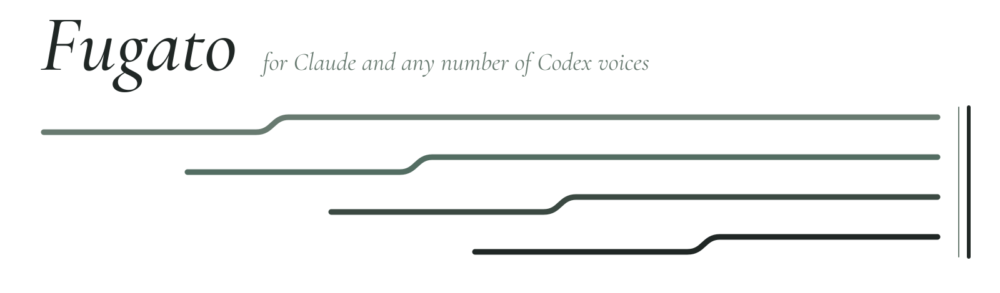
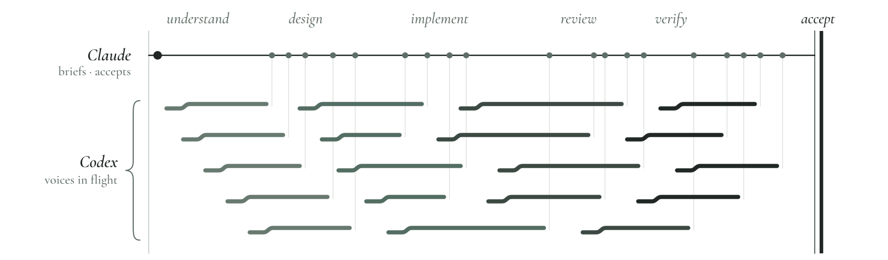
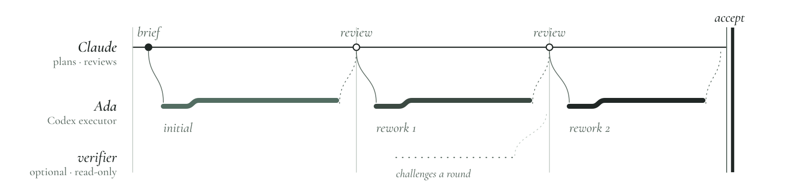
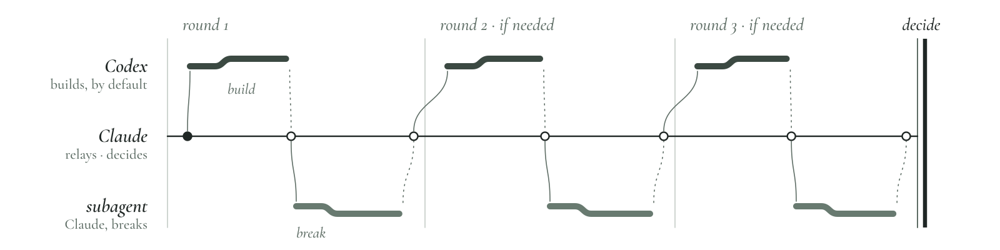
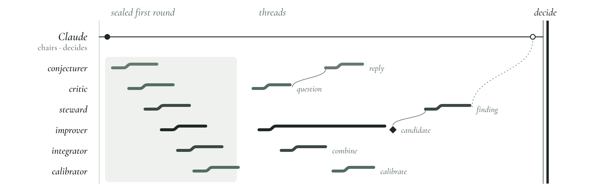

<picture>
  <source media="(prefers-color-scheme: dark)" srcset="docs/assets/fugato-banner-dark.svg">
  
</picture>

**Claude plans. Codex works. Claude accepts.** Fugato is a Claude Code plugin with a companion CLI. Claude writes the acceptance
criteria and a bounded brief for each task. Codex workers investigate, implement
and review on their own threads and hand back structured reports. Claude checks
the evidence, records a verdict and integrates the work.

<a href="#install">Install</a> &nbsp;·&nbsp; <a href="#quick-start">Quick start</a> &nbsp;·&nbsp; <a href="#modes">Modes</a> &nbsp;·&nbsp; <a href="docs/commands.md">Documentation</a> &nbsp;·&nbsp; <a href="plugins/codex/CHANGELOG.md">Changelog</a>

## Install

In Claude Code:

```text
/plugin marketplace add Ghqqqq/fugato
/plugin install codex@fugato
/reload-plugins
/codex:setup
```

Setup checks the runtime and, when sign-in is needed, prints the login command
for Fugato's separate Codex home. Requires Claude Code 2.1.302+, Node.js 18.18+
and a Codex CLI with `app-server` support (tested with 0.146.0). Sign in with a
ChatGPT plan or an OpenAI API key; workers count toward your Codex usage.
For the live pane, add `/plugin install codex-live@fugato`.

Coming from Duet? Your state carries over: see the [upgrade guide](docs/upgrading-from-duet.md).

## Quick start

```text
/codex:pair fix the failing parser test
```

Claude scopes the task and writes the brief. One Codex worker investigates,
makes the change and runs its checks. Claude reads the diff and reruns the
checks before accepting it. Plain requests work too:

```text
Have Codex investigate the flaky integration tests, and have another worker
review the retry logic in src/net/ in parallel. Keep both tasks read-only.
```

## Modes

<table>
<tr>
<td width="136">
<picture>
  <source media="(prefers-color-scheme: dark)" srcset="docs/assets/fugato-glyph-ultra-dark.svg">
  
</picture>
</td>
<td>
<b><a href="docs/ultra-codex.md">Ultra</a></b><br>
Broad work fanned out to many bounded workers: parallel readers, independent designs, one owner per area, area&nbsp;×&nbsp;lens review and adversarial checks. Each result is accepted before it moves on.<br>
<code>/codex:ultra-codex &lt;task&gt;</code>
</td>
</tr>
<tr>
<td width="136">
<picture>
  <source media="(prefers-color-scheme: dark)" srcset="docs/assets/fugato-glyph-pair-dark.svg">
  
</picture>
</td>
<td>
<b><a href="docs/pair.md">Pair</a></b><br>
One task, one Codex executor on one thread. Claude reads every diff and reruns the checks; at most two rework rounds.<br>
<code>/codex:pair &lt;task&gt;</code>
</td>
</tr>
<tr>
<td width="136">
<picture>
  <source media="(prefers-color-scheme: dark)" srcset="docs/assets/fugato-glyph-duel-dark.svg">
  
</picture>
</td>
<td>
<b><a href="docs/duel.md">Duel</a></b><br>
A Codex worker and a Claude subagent build and break, or draft and cross-review. Claude relays the evidence and decides.<br>
<code>/codex:duel &lt;task&gt;</code>
</td>
</tr>
<tr>
<td width="136">
<picture>
  <source media="(prefers-color-scheme: dark)" srcset="docs/assets/fugato-glyph-roundtable-dark.svg">
  
</picture>
</td>
<td>
<b><a href="docs/roundtable.md">Roundtable</a></b><br>
Persistent Codex personas pursue one goal through a shared forum. Claude chairs and accepts the final candidate on evidence.<br>
<code>/codex:roundtable &lt;task&gt;</code>
</td>
</tr>
</table>

Add `on` to keep a mode for the session, as in `/codex:pair on`; without it a
task runs once. Duel's Claude participant uses your Claude quota.

### Ultra

<picture>
  <source media="(prefers-color-scheme: dark)" srcset="docs/assets/fugato-score-ultra-dark.svg">
  
</picture>

Claude splits the work-list across parallel readers, independent designs with judges, one implementer per
disjoint area, area × lens reviews and adversarial verification. Accepted items advance as slots open.
After one failed live fix, competing hypotheses and a separate live diagnostic come before another fix.
`--quick` and `--thorough` set the depth; `--max-workers` caps concurrency, never coverage. [More](docs/ultra-codex.md).

### Pair

<picture>
  <source media="(prefers-color-scheme: dark)" srcset="docs/assets/fugato-score-pair-dark.svg">
  
</picture>

Claude writes the criteria and a full brief, then one Codex worker does the task end to end on a single
thread. Claude reads every diff and reruns the checks itself. At most two rework rounds follow the first
delivery, and an optional read-only verifier can challenge a round. When the task outgrows one worker,
Claude recommends ultra or duel; it never switches on its own. [More](docs/pair.md).

### Duel

<picture>
  <source media="(prefers-color-scheme: dark)" srcset="docs/assets/fugato-score-duel-dark.svg">
  
</picture>

For code and bugs, Codex builds by default and a Claude subagent tries to break the change; each finding
gets an answer before the next round. For design questions, both draft blind, cross-review, and Claude
decides on the evidence. The parties never talk directly and no one accepts their own work. Up to three
rounds; the Claude participant uses your Claude quota. [More](docs/duel.md).

### Roundtable

<picture>
  <source media="(prefers-color-scheme: dark)" srcset="docs/assets/fugato-score-roundtable-dark.svg">
  
</picture>

Two to six Codex personas (conjecturer, critic, steward, improver, integrator, calibrator) work toward
one goal through a public forum. Each first posts an independent record, then members answer one
another in threads; Claude chairs and accepts a reviewed candidate on evidence. Choose `light`,
`standard`, `deep` or `full`, or name the seats with `--roles`; redefine a persona's model with
`fugato setup --persona-model`. [More](docs/roundtable.md).

## How it works

1. **Brief.** Claude defines the acceptance criteria and gives each worker a
   bounded assignment: context, owned paths and the checks to run.
2. **Work.** Each worker runs on its own Codex thread and can ask Claude a
   question mid-task; the answer continues the same turn.
3. **Report.** The worker hands back a structured report that separates the
   commands it actually ran from what it claims, with assumptions and blockers.
4. **Accept.** Claude checks the evidence against the criteria, asks for
   corrections where needed, records a verdict in the run journal and integrates.

## Highlights

- **Native subagents.** `Agent(subagent_type: "codex:codex-native")` runs a Codex
  worker like any Claude Code subagent. SendMessage steers it; `/tasks` stops it.
- **Evidence over claims.** Captured commands are kept apart from what Codex says
  it ran, so acceptance rests on what was observed.
- **A journal that survives compaction.** Goal, criteria, verdicts and linked
  briefs stay in a run journal: `fugato journal show`.
- **Live view.** The optional `codex-live` pane shows each worker's commands,
  edits and questions at no Claude token cost.
- **A separate Codex home.** Sign-in, threads and job state live in
  `~/.claude/codex-isolated`; your everyday `~/.codex` is left alone.

## Good to know

- Codex runs with full access by default. The separate home separates state, not
  files: give parallel writers disjoint paths or separate worktrees.
- Codex edits bypass Claude Code's permission prompts unless you turn on
  permission mapping with `fugato setup --permission-mapping claude`.
- Codex tokens appear in Fugato reports and `codex-live`, not in Claude's `/usage`.

## Documentation

| Topic | Page |
| --- | --- |
| Commands and CLI | [Commands](docs/commands.md) |
| Modes | [Ultra](docs/ultra-codex.md) · [Pair](docs/pair.md) · [Duel](docs/duel.md) · [Roundtable](docs/roundtable.md) |
| Dispatch, reports, questions and recovery | [Direct mode](docs/direct-mode.md) · [Worker lifecycle](docs/worker-lifecycle.md) |
| Settings, sandbox, browser and Computer Use | [Configuration](docs/configuration.md) · [Browser](docs/browser-approvals.md) · [Computer Use](docs/computer-use-approvals.md) |
| Run journal | [Run journal](docs/run-journal.md) |
| State, cleanup and troubleshooting | [State and retention](docs/state-and-retention.md) · [Troubleshooting](docs/troubleshooting.md) |
| Release notes | [Changelog](plugins/codex/CHANGELOG.md) |

## Development

```bash
npm ci
npm install -g "@openai/codex@$(cat .codex-version)" "@anthropic-ai/claude-code@$(cat .claude-code-version)"
npm run verify
```

`npm run verify` checks version metadata, builds TypeScript and runs the runtime,
live-pane, native-integration and plugin tests against temporary Codex homes.

## License

Apache-2.0. See [LICENSE](LICENSE) and [NOTICE](NOTICE). Fugato is a fork of
[openai/codex-plugin-cc](https://github.com/openai/codex-plugin-cc); the review and
rescue commands come from upstream, the worker runtime, orchestration modes and
live view are Fugato additions.

<br>

<p align="center"><sub><i>fugato</i> · in the style of a fugue: distinct voices developing a shared subject.</sub></p>
